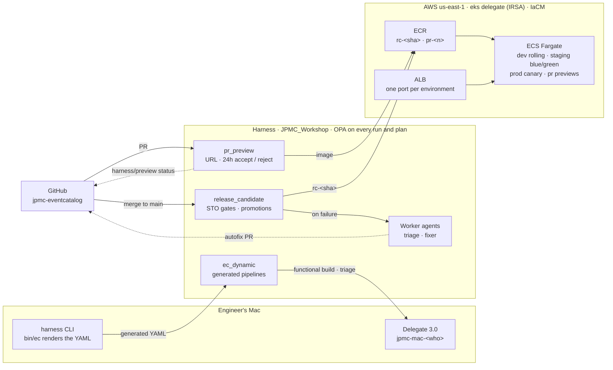

The delivery platform for this catalog is modelled in the catalog itself:

- [[domain|delivery]] is the domain. Its services are the Harness pipelines, and its messages are the hand-offs between them.
- [[flow|clone-to-governed-release]] walks one change from PR → preview → merge → `rc-<sha>` → dev → staging → prod, including the failure branch to the autofix agents.
- Entry points: [[service|delivery-cli]], [[service|pr-preview]], [[service|rc-build]], [[service|promotion-gate]], [[service|ecs-runtime]], [[service|release-orchestration]] and [[service|rc-autofix-agents]].

This page covers only what the model doesn't show.

## Architecture

## AWS runtime topology

Everything runs behind one shared Application Load Balancer, `jpmc-eventcatalog`. Each environment and each PR preview gets its own listener port and target group, so a new preview needs no DNS change. Workloads are static nginx images on ECS Fargate, pulled from ECR repository `jpmc-eventcatalog` (immutable tags, scan on push, `pr-*` images expire after 7 days).

| Port | Serves | Access |
|---|---|---|
| 80 | prod (canary) | open |
| 8199 | staging, live (blue/green) | restricted CIDRs |
| 8197 | staging blue/green test listener | restricted CIDRs |
| 8198 | dev (rolling) | restricted CIDRs |
| 8100–8196 | per-PR previews (`pr-<n>` → `8100 + n mod 97`) | restricted CIDRs |

Ports for unreleased builds accept only `preview_ingress_cidrs`, which holds the corporate egress range plus the `eks` delegate's NAT address used by Http verification. The IaC rejects `0.0.0.0/0` for that list. Tasks accept port 80 from the ALB security group only.

| IaCM workspace | Contains |
|---|---|
| `jpmc_base` | ALB, security groups, ECR, log group, prod target groups |
| `jpmc_slot_staging` | Staging port and target group, plus the `:8197` test listener and green TG for blue/green |
| `jpmc_pv_pr_<n>` | One preview port and target group per PR, tagged `layer=preview` and `expires_at` |

CD owns listener routing: IaC leaves listener default actions to the pipelines (`ignore_changes`). AWS access is keyless. CI and IaCM use an OIDC connector scoped to the project, and CD uses IRSA on the `eks` delegate.

## Policy inheritance

OPA policy sets are inherited, so every project run is evaluated against account, org and project sets.

| Scope | Policy | When | Severity |
|---|---|---|---|
| account | `jpmc_warn_missing_owner_tag` | on run | warn |
| org | `jpmc_block_mutable_tags` (`latest`, `main`, `dev`) | on run | block |
| project | `jpmc_block_prod_without_rollback` | on save + on run | block |
| project | `jpmc_warn_generated_shellscript` | on run | warn |
| project | `jpmc_plan_block_shared_destroy` | after Terraform plan | block |
| project | `jpmc_plan_warn_public_ingress` | after Terraform plan | warn |
| project | `jpmc_promotion_gate` | Policy step in [[service\|promotion-gate]] | block |

Dynamic pipeline YAML generated by `bin/ec` is evaluated by the same on-run sets as saved pipelines.
