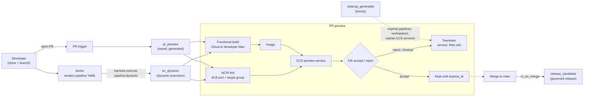
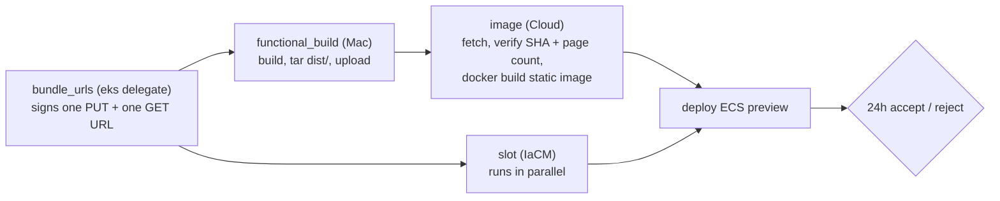

This catalog is delivered by a platform built on Harness. A change goes through three stages: **clone → preview → governed release**. Every step is driven from the `harness` CLI. A small renderer, `bin/ec`, generates the pipeline YAML, and Harness runs it headless.

## End-to-end flow

## Building blocks

| Component | Role |
|---|---|
| `harness` CLI | The single interface. It runs, approves, retries, and creates or updates pipelines. |
| `bin/ec` | A Python renderer. It prints generated pipeline YAML to stdout and makes no API calls. |
| `ec_dynamic` | A saved pipeline used as the execution shell for dynamic runs. The YAML that actually ran is stored on each execution. |
| `pr_preview` | The saved preview pipeline that PR triggers start. It is regenerated from the same code with `ec pr-pipeline`. |
| IaCM (OpenTofu) | Creates one workspace per preview slot (`jpmc_pv_pr_<n>`). Each slot gets its own ALB listener port and target group. |
| ECS on Fargate | Runs one service per preview (`jpmc-eventcatalog-pr-<n>`). |
| `cleanup_generated` | An hourly janitor. It removes expired generated pipelines, preview services and workspaces, plus orphan services. |

## Why both dynamic and saved pipelines

Dynamic executions cannot use triggers, input sets, runtime inputs, selective stages or retry. The design works around that:

- **Interactive use** goes through `bin/ec … | harness execute pipeline:dynamic ec_dynamic -f -`. Values are baked into the generated YAML, which you can review.
- **PR triggers** start the *saved*, generated `pr_preview` pipeline, because triggers cannot start a dynamic run.
- **Retry**: `ec preview --save` stores the generated YAML as a real pipeline tagged `generated_by=ec` and `expires_at`. It can then be retried by stage, and the janitor deletes it once it expires.

Dynamic YAML is governed like saved YAML. On-run OPA policy sets evaluate the YAML that is actually executing. Running it needs *Edit + Execute* on `ec_dynamic`, and each run is attributed to its caller in the audit trail.

## PR preview: where the build runs

The functional build is the same script in both cases. It can run on Harness Cloud or on the developer's own Mac, which is registered as a Delegate 3.0 (`jpmc-mac-<who>`).

- **No credential on the laptop.** The `eks` delegate signs short-lived URLs for one bundle object. The Mac can write only that key.
- **Integrity.** The Mac reports a SHA-256 and a page count. Cloud recomputes both and fails on any mismatch.
- **Provenance.** `version.json` carries a `-m<run>` label, so the preview shows that the Mac produced it.
- **Trade-off.** The laptop path was about 50 s slower end to end in the measured run. In exchange, the reviewer sees the exact build the developer ran, and Cloud never compiles the source.

## Preview lifecycle

| Event | Result |
|---|---|
| PR opened, or `ec preview <n>` | Upserts workspace `jpmc_pv_pr_<n>` (tagged `layer=preview`, `pr`, `expires_at`), provisions a port and target group, deploys the ECS service, and posts the URL into a 24h approval |
| Accept | The preview is kept until `expires_at` |
| Reject or timeout | Tears down the ECS service, then the IaCM slot |
| Half-failed run or aborted teardown | The hourly janitor picks it up at expiry or as an orphan |

After merge to `main`, trigger `rc_on_merge` starts `release_candidate`. See [Release and promotion path](/docs/custom/delivery/02-release-and-promotion).
