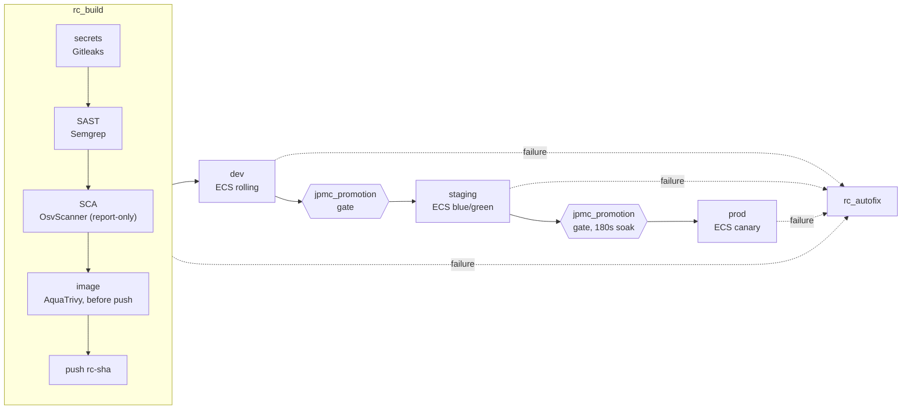
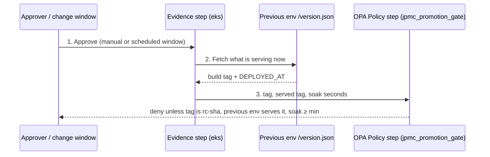
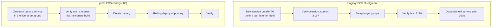
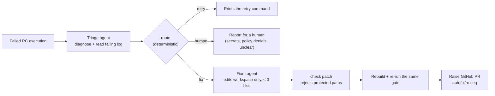

A merge to `main` starts `release_candidate` (trigger `rc_on_merge`). The pipeline builds one image and tags it `rc-<sha>`. That tag is promoted through three environments without being rebuilt. Each environment uses one deployment strategy:

- **dev**: rolling
- **staging**: blue/green
- **prod**: canary

## Pipeline

### Security gates (STO)

| Gate | Scanner | Fails on |
|---|---|---|
| secrets | Gitleaks (repository) | medium, because committed keys are filed as Medium. A reviewed allowlist lives in `.gitleaks.toml` |
| SAST | Semgrep (repository) | critical |
| SCA | OsvScanner (repository) | report-only |
| image | AquaTrivy on the locally built image, before push | critical |

The image is pushed as `rc-<sha>` only after all gates pass. Every deployment stage reads that one tag.

## Promotion gate: stage template `jpmc_promotion`

Both `approve_staging` and `approve_prod` use the same stage template.

1. **Approve.** This is a manual `HarnessApproval` or a scheduled change window (`prod_window`). The window approves itself at the set time unless someone approves early or rejects. The default is `none`, so prod stays a manual click, and `rc_on_merge` never schedules prod.
2. **Fresh evidence.** *After* the approval, a step reads the previous environment's `/version.json`. It computes soak time from the `DEPLOYED_AT` recorded when that environment was deployed.
3. **Policy.** An OPA `Policy` step on set `jpmc_promotion_gate` denies promotion if any of these is true:
   - the tag is not an immutable `rc-<sha>`;
   - the previous environment serves something else;
   - it has not soaked for `min_soak_seconds` (0 for staging, 180 for prod).

The policy runs after the click, so it judges what is running *now*. An approval given earlier cannot promote an environment that has since been redeployed.

## Deployment strategies

- **Staging rollback** is `EcsBlueGreenRollback`, which swaps the listener back. The prod gate reads staging evidence from `:8199`, which is what staging is serving after the swap.
- **Prod rollback** is `EcsCanaryDelete` plus `EcsRollingRollback`, under `spec.execution.rollbackSteps`. Policy `jpmc_block_prod_without_rollback` enforces this.
- **One strategy per environment.** ECS blue/green owns the services it creates, so an environment never mixes rolling and blue/green.

## Failure path: `rc_autofix` worker agents

If any stage of `release_candidate` fails, its last stage starts `rc_autofix` with the failed execution id.

- **The agents hold no write credentials.** They run as service account `jpmc_rc_agent`, which has project read-only access plus LLM gateway access. The GitHub token exists only in the deterministic `raise pr` step.
- **Guardrails are code, not prompts.** The `check patch` step rejects changes to `.gitleaks.toml`, `.trivyignore*`, `.harness/`, IaC, ECS definitions and tests, and rejects patches over 3 files. The fix must then pass the same gate the release failed.
- The PR body contains the agent's `fix.md` and a verification section written by the pipeline, not by the agent.

## Release Orchestration

Release Orchestration process `eventcatalog_release` runs the same artifact through phases `jpmc_rc` → `jpmc_staging` → `jpmc_prod`. Its activities run `rc_build` and the deploy pipelines. Outputs are chained across phases (`IMAGE_TAG` → dev `DEPLOYED_TAG` → staging → manual prod approval → prod) using `phase.<phase>.activity.<activity>.outputs.<name>` references. Starting a release has no API and is a UI action.

## Policy inheritance

OPA policy sets are inherited, so a project run is evaluated against account, org and project sets.

| Scope | Policy | Severity |
|---|---|---|
| account | `jpmc_warn_missing_owner_tag` | warn |
| org | `jpmc_block_mutable_tags` (`latest`, `main`, `dev`) | block |
| project | `jpmc_block_prod_without_rollback` (on save and on run) | block |
| project | `jpmc_warn_generated_shellscript` | warn |
| project | `jpmc_plan_block_shared_destroy` (after Terraform plan) | block |
| project | `jpmc_plan_warn_public_ingress` (after Terraform plan) | warn |
| project, step | `jpmc_promotion_gate` | block |
