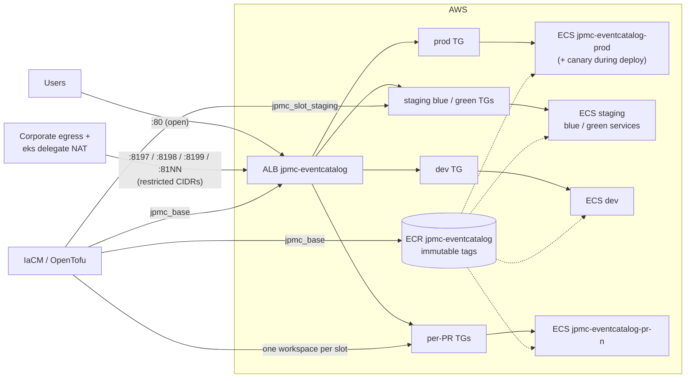

Every environment and every PR preview shares one Application Load Balancer, `jpmc-eventcatalog`. Each one gets its own listener port and target group, so a new preview needs no DNS change. The containers are static nginx images running as ECS Fargate services.

## Port map

| Port | Serves | Access |
|---|---|---|
| 80 | prod | open |
| 8199 | staging (live) | restricted CIDRs |
| 8197 | staging blue/green test listener | restricted CIDRs |
| 8198 | dev | restricted CIDRs |
| 8100–8196 | per-PR previews (`pr-<n>` → `8100 + n mod 97`, for example `pr-43` → 8143) | restricted CIDRs |

Ports 8197–8199 are reserved for the long-lived slots. Ports for unreleased builds accept only `preview_ingress_cidrs`. That list holds the corporate egress range plus the `eks` delegate's NAT address, which the pipelines' Http verification steps need. The IaC rejects `0.0.0.0/0` for that list.

## Infrastructure layers

| Layer | IaCM workspace | Contains |
|---|---|---|
| Base (long-lived) | `jpmc_base` | ALB, security groups, ECR repository (immutable tags, scan on push, `pr-*` images expire after 7 days), log group, prod target groups |
| Long-lived slots | for example `jpmc_slot_staging` | Listener port and target group. Staging adds a test listener (`test_port=8197`) and a green target group for blue/green |
| Preview slots | `jpmc_pv_pr_<n>` | One listener port and target group per PR, tagged `layer=preview` and `expires_at` |

- **CD owns the listener routing.** IaC leaves listener default actions to the deployment pipelines (`ignore_changes`), so blue/green swaps are not reverted by the next plan.
- **Fargate tasks accept traffic on port 80 from the ALB security group only.**
- **AWS access is keyless.** CI and IaCM use an OIDC connector scoped to the project. CD and shell steps use IRSA on the `eks` delegate.
